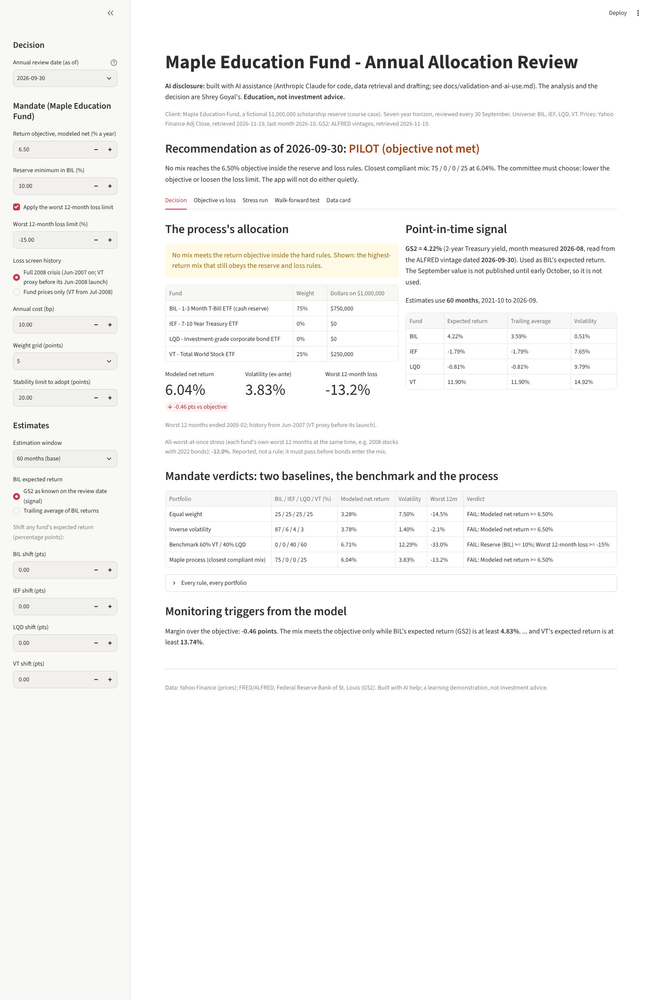
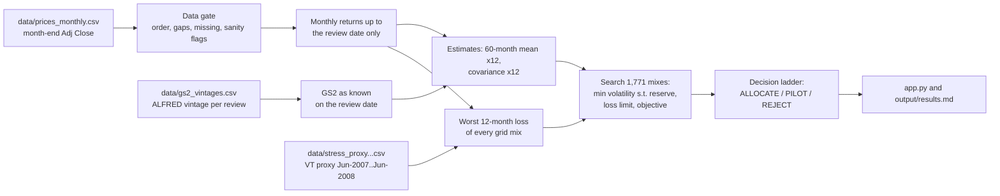

# Maple Education Fund - Annual Allocation Review (FIN 43900 Project 2)

> **AI disclosure:** I used Anthropic Claude (Opus 5.5, in the Claude app) to write the code, retrieve the data and draft the documents. The full record is in [`docs/validation-and-ai-use.md`](docs/validation-and-ai-use.md). **The analysis and the decision are mine** (Shrey Goyal).
>
> **Education, not investment advice.** The client is a fictional course case.

**Decision (review as of 30 September 2026): PILOT the process for one year; do not adopt it.** Allocate the $1,000,000 scholarship reserve to **75% BIL / 25% VT** (range BIL 75-80%, VT 20-25%). The committee must resolve a conflict in its own mandate: the 6.5% return objective and the -15% worst-12-month loss limit cannot both be met once the whole 2008 crisis is counted (best return inside the limit: 6.04%). Memo: [`docs/decision-memo.md`](docs/decision-memo.md). Executed output, readable without running anything: [`output/results.md`](output/results.md).

| | |
|---|---|
| **Intended user** | The Maple Education Fund investment committee: non-specialists who approve the reserve's allocation once a year |
| **Action** | Allocate, rebalance, pilot or reject the allocation process at each 30 September review |
| **Horizon and constraints** | 7 years, reviewed annually; long-only, fully invested, 5-point weights; at least 10% in BIL (award reserve); worst 12-month loss no worse than -15%; modeled net return objective 6.5% |
| **Universe and benchmark** | BIL (T-bills), IEF (7-10 yr Treasuries), LQD (investment-grade corporates), VT (world stocks); benchmark 60% VT / 40% LQD |
| **Point-in-time signal** | GS2, the 2-year Treasury yield, read from the ALFRED vintage dated the review date, as BIL's expected return |



## Run it (about 5 minutes the first time)

You need Python 3.11 or newer ([python.org](https://www.python.org/downloads/)) and this repository on your computer (green **Code** button → **Download ZIP**, unzip, or `git clone`). Open a terminal **in the repository folder**, then:

```bash
python -m venv .venv
# Windows:   .venv\Scripts\activate
# Mac/Linux: source .venv/bin/activate
python -m pip install -r requirements.txt
python run_analysis.py          # rebuilds output/results.md and prints the decision line
python -m pytest -q             # 36 tests, including the course's Lab 14/15 known answers
python -m streamlit run app.py  # opens the app in your browser
```

On a Mac, type `python3` where it says `python` if `python` is not found. No internet, API key or account is needed: everything runs from the files in `data/`.

**Expected:** `run_analysis.py` prints
`PILOT (objective not met): 75 / 0 / 0 / 25 (BIL/IEF/LQD/VT) | modeled net return 6.04% vs objective 6.50% | worst 12m -13.2% | window spread 35 pts`.

### Using the app (one control, one verdict)

- The headline shows the recommendation and why. **Decision** tab: the allocation in dollars, the GS2 reading (value, month measured, vintage date), and the pass/FAIL verdict of equal weight, inverse volatility, the benchmark and the process, naming the rule each one breaks.
- Try **Worst 12-month loss limit = -20** in the sidebar: the process can now reach 6.5% (65/35) and the headline changes. Try **Return objective = 6.0**: 75/25 meets every rule.
- **Objective vs loss**: what each point of tolerated loss buys. **Stress run**: windows, estimates, costs, constraints, and the conditions that stop the process. **Walk-forward test**: the process decided each 30 September since 2013 with only what was known then. **Data card**: sources and sanity flags.
- Pick an earlier **Annual review date** to see what the process said in that year.

## How it works



| File | What it does |
|---|---|
| [`engine.py`](engine.py) | Every finance calculation: data gate, estimates, point-in-time GS2, mandate rules, grid search, loss screen, baselines, stress run, walk-forward test |
| [`app.py`](app.py) | The Streamlit app. No math of its own; it calls `engine.py` |
| [`run_analysis.py`](run_analysis.py) | One command → `output/results.md`, `output/results.json`, charts |
| [`lcir.py`](lcir.py) | Runs the Locked Changed-Input Record; refuses unless the prediction is committed first |
| [`fetch_data.py`](fetch_data.py) | Optional: rebuilds the data from Yahoo Finance and ALFRED and compares with the snapshot |
| [`tests/`](tests) | Known answers (Labs 14-15), no look-ahead, data gate, the app itself, memo vs output |
| [`data/`](data) | Frozen inputs with sources, dates and hashes ([`provenance.json`](data/provenance.json)) |
| [`docs/`](docs) | [Decision memo](docs/decision-memo.md) · [Validation and AI use](docs/validation-and-ai-use.md) · [Data card](docs/data-card.md) · [Manifest](docs/manifest.md) · Transcripts: [1](docs/transcript-video-1.txt), [2](docs/transcript-video-2.txt), [3](docs/transcript-video-3.txt) |

**Conventions:** monthly simple returns on Adj Close; expected return = monthly mean x 12; covariance = sample covariance x 12; modeled net return = weights x expected returns - 0.10% a year; worst 12-month loss = lowest compounded 12-month return of the mix rebalanced monthly, from June 2007 (VT proxy before its launch). Weights are on a 5-point grid and the search is exhaustive.

## Data sources

| Data | Source | As of |
|---|---|---|
| BIL, IEF, LQD, VT month-end Adj Close, Jun-2008 to Oct-2026 | Yahoo Finance chart API | retrieved 2026-11-19 |
| GS2 vintages, one per 30 September, 2009-2026 | ALFRED / FRED, Federal Reserve Bank of St. Louis (Fed H.15) | retrieved 2026-11-19 |
| VTSMX, VGTSX (VT proxy for the loss screen only), May-2007 to Dec-2010 | Yahoo Finance chart API | retrieved 2026-11-19 |

Details, revisions, licences and checks: [`docs/data-card.md`](docs/data-card.md).

## Known limitations

- Bond expected returns are trailing 60-month averages, negative after 2022; with yield-like estimates bonds would enter (stress table). The memo makes this the pilot year's redesign.
- VT before June 2008 is a 40/60 VTSMX/VGTSX proxy, used only in the loss screen.
- Returns are arithmetic annual estimates, not compound growth.
- The walk-forward test has 13 annual decisions: too few to prove the process, enough to show it should not be adopted yet.
- The client is fictional; the -15% loss limit is the client's answer to the question left open in Lab 15.

No passwords, keys or personal data are used or stored. `.env` files are ignored by git.
