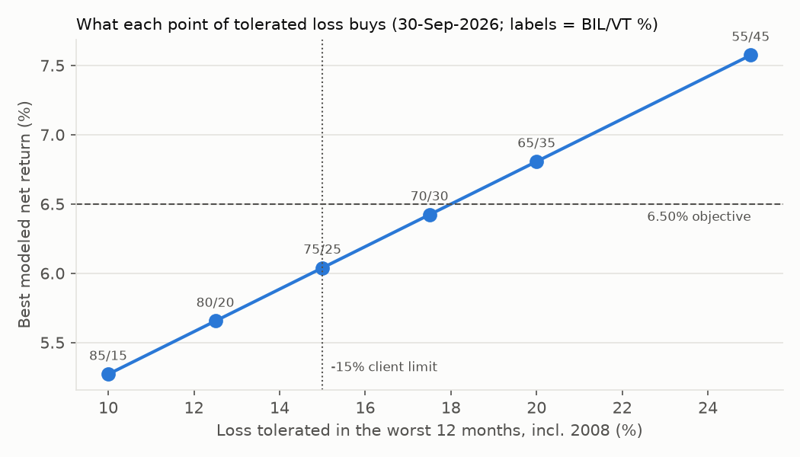
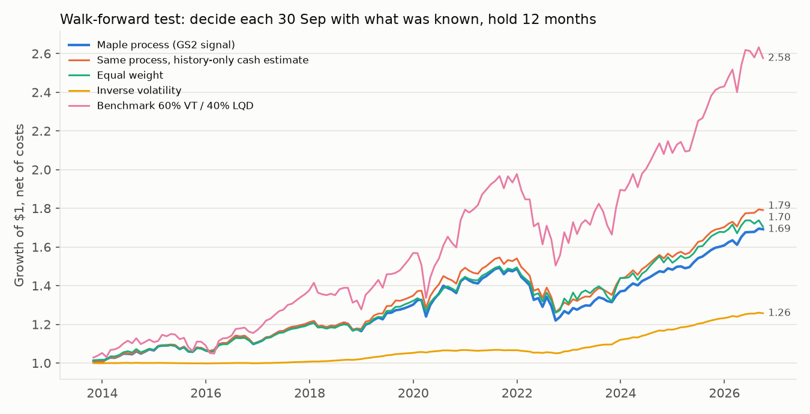

# Maple Education Fund - executed results

> **AI disclosure:** built with AI assistance (Anthropic Claude: code, data retrieval, drafting). The analysis and the decision are Shrey Goyal's. **Education, not investment advice.**

Generated by `python run_analysis.py` on 2026-11-24 02:54 UTC. Review date (as of): **2026-09-30**. Prices through **2026-10-30** (`data/prices_monthly.csv`, sha256 `d411a2247724`); GS2 vintages `data/gs2_vintages.csv` (sha256 `c9388de70804`). Both retrieved 2026-11-19.

## 1. Decision

**PILOT (objective not met).** No mix reaches the 6.50% objective inside the reserve and loss rules. Closest compliant mix: 75 / 0 / 0 / 25 at 6.04%. The committee must choose: lower the objective or loosen the loss limit. The app will not do either quietly.

| Fund | Weight | Dollars on $1,000,000 |
|---|---|---|
| BIL - 1-3 Month T-Bill ETF (cash reserve) | 75% | $750,000 |
| IEF - 7-10 Year Treasury ETF | 0% | $0 |
| LQD - Investment-grade corporate bond ETF | 0% | $0 |
| VT - Total World Stock ETF | 25% | $250,000 |

Modeled net return **6.04%** (objective 6.50%, gap -0.46 pts) · ex-ante volatility **3.83%** · worst 12-month loss, Jun-2007 on, **-13.2%** (12 months to 2009-02) · reserve **75%**.

Point-in-time signal: **GS2 = 4.22%**, month measured 2026-08, ALFRED vintage 2026-09-30. Estimates: 60 months, 2021-10 to 2026-09.

| Fund | Expected return used | Trailing 60-month average | Volatility |
|---|---|---|---|
| BIL | 4.22% | 3.59% | 0.51% |
| IEF | -1.79% | -1.79% | 7.65% |
| LQD | -0.81% | -0.81% | 9.79% |
| VT | 11.90% | 11.90% | 14.92% |

After the review (live, not used in any decision): October 2026 return of the 75/25 mix = **-0.14%** net.

## 2. Baselines and mandate verdicts

| Portfolio | BIL / IEF / LQD / VT | Modeled net return | Volatility | Worst 12m (Jun-2007 on) | Verdict |
|---|---|---|---|---|---|
| Equal weight | 25 / 25 / 25 / 25 | 3.28% | 7.50% | -14.5% | FAIL: Modeled net return >= 6.50% |
| Inverse volatility | 87 / 6 / 4 / 3 | 3.78% | 1.40% | -2.1% | FAIL: Modeled net return >= 6.50% |
| Benchmark 60% VT / 40% LQD | 0 / 0 / 40 / 60 | 6.71% | 12.29% | -33.0% | FAIL: Reserve (BIL) >= 10%; Worst 12-month loss >= -15% |
| Maple process (closest compliant mix) | 75 / 0 / 0 / 25 | 6.04% | 3.83% | -13.2% | FAIL: Modeled net return >= 6.50% |

## 3. The committee's menu: objective vs loss limit

| Loss limit | BIL / IEF / LQD / VT | Best modeled net return | Volatility | Worst 12m | Meets 6.50%? |
|---|---|---|---|---|---|
| -10.0% | 85 / 0 / 0 / 15 | 5.27% | 2.37% | -7.6% | no |
| -12.5% | 80 / 0 / 0 / 20 | 5.66% | 3.09% | -10.4% | no |
| -15.0% | 75 / 0 / 0 / 25 | 6.04% | 3.83% | -13.2% | no |
| -17.5% | 70 / 0 / 0 / 30 | 6.42% | 4.56% | -15.9% | no |
| -20.0% | 65 / 0 / 0 / 35 | 6.81% | 5.30% | -18.5% | yes |
| -25.0% | 55 / 0 / 0 / 45 | 7.57% | 6.78% | -23.5% | yes |

## 4. Stability across estimation windows

| Window | Months | Meets objective | BIL | IEF | LQD | VT | Modeled return | Worst 12m | VT estimate |
|---|---|---|---|---|---|---|---|---|---|
| 36 months | 2023-10 to 2026-09 | yes | 85 | 0 | 0 | 15 | 6.52% | -7.6% | 20.25% |
| 60 months (base) | 2021-10 to 2026-09 | no (closest compliant) | 75 | 0 | 0 | 25 | 6.04% | -13.2% | 11.90% |
| 120 months | 2016-10 to 2026-09 | no (closest compliant) | 75 | 0 | 0 | 25 | 6.26% | -13.2% | 12.77% |
| All history | 2008-07 to 2026-09 | no (closest compliant) | 50 | 0 | 25 | 25 | 5.54% | -14.7% | 9.88% |

Largest weight move across windows: **35 points** (adopt limit 20).

## 5. Stress run (estimates, window, costs, constraints, data)

| Group | Change | Meets objective | BIL / IEF / LQD / VT | Modeled return | Volatility | Worst 12m | Largest move vs base (pts) |
|---|---|---|---|---|---|---|---|
| Base case | - | no | 75 / 0 / 0 / 25 | 6.04% | 3.83% | -13.2% | 0 |
| Estimates | VT expected return -1 point | no | 75 / 0 / 0 / 25 | 5.79% | 3.83% | -13.2% | 0 |
| Estimates | VT expected return -3 points | no | 75 / 0 / 0 / 25 | 5.29% | 3.83% | -13.2% | 0 |
| Estimates | BIL (GS2 signal) -1 point: cash rates fall | no | 75 / 0 / 0 / 25 | 5.29% | 3.83% | -13.2% | 0 |
| Estimates | Signal off: BIL from 60-month history | no | 75 / 0 / 0 / 25 | 5.57% | 3.83% | -13.2% | 0 |
| Estimates | IEF and LQD +6 points (to 4.2% / 5.2%; yield-like, see memo) | yes | 30 / 30 / 10 / 30 | 6.52% | 7.13% | -14.9% | 45 |
| Window | Last 36 months | yes | 85 / 0 / 0 / 15 | 6.52% | 1.79% | -7.6% | 10 |
| Window | Last 120 months | no | 75 / 0 / 0 / 25 | 6.26% | 3.73% | -13.2% | 0 |
| Window | All history since Jul-2008 | no | 50 / 0 / 25 / 25 | 5.54% | 5.52% | -14.7% | 25 |
| Costs | Annual cost 10 -> 35 bp | no | 75 / 0 / 0 / 25 | 5.79% | 3.83% | -13.2% | 0 |
| Costs | Annual cost 10 -> 75 bp | no | 75 / 0 / 0 / 25 | 5.39% | 3.83% | -13.2% | 0 |
| Constraints | Reserve minimum 10% -> 20% | no | 75 / 0 / 0 / 25 | 6.04% | 3.83% | -13.2% | 0 |
| Constraints | Loss limit -15% -> -20% (looser) | yes | 65 / 0 / 0 / 35 | 6.81% | 5.30% | -18.5% | 10 |
| Constraints | Loss limit removed | yes | 65 / 0 / 0 / 35 | 6.81% | 5.30% | -18.5% | 10 |
| Data window | Loss screen on fund prices only (VT from Jul-2008) | yes | 65 / 0 / 0 / 35 | 6.81% | 5.30% | -9.3% | 10 |
| Constraints | Grid 5 -> 10 points (coarser) | no | 80 / 0 / 0 / 20 | 5.66% | 3.09% | -10.4% | 5 |

**Why the full-crisis screen matters:** on fund prices alone (VT starts Jul-2008) the process picks 65 / 0 / 0 / 35 and reports a worst 12-month loss of -9.3%. Counting Mar-2008 to Feb-2009 (VT proxy before launch), that same mix loses **-18.5%** (12 months to 2009-02), beyond the -15% limit.

**All-worst-at-once stress** (each fund's own worst 12 months at the same time: BIL -0.2%, IEF -16.4%, LQD -21.9%, VT -47.4%): 75/25 loses **-12.0%**; the bond-heavy 30/30/10/30 mix from the bond-yield stress loses **-21.4%**, past the limit. Reported, not a hard rule.

**Break-evens for the 75/25 mix:** margin over objective -0.46 pts; meets 6.50% only if GS2 >= 4.83% and VT's estimate >= 13.74%.

## 6. Walk-forward test, Oct-2013 to Sep-2026

Each 30 September the process decides with only the prices and GS2 vintage known that day; holds 12 months with drifting weights; pays 10 bp a year plus 10 bp per 100% traded.

| Strategy | Annual return | Volatility | Max drawdown | Worst 12m | 12m windows >= 6.5% | 12m windows < -15% |
|---|---|---|---|---|---|---|
| Maple process (GS2 signal) | 4.13% | 5.50% | -18.3% | -16.4% (2022-09) | 41% | 2.1% |
| Same process, history-only cash estimate | 4.58% | 5.72% | -18.3% | -16.4% (2022-09) | 46% | 2.1% |
| Equal weight | 4.19% | 5.74% | -16.0% | -14.5% (2022-10) | 41% | 0.0% |
| Inverse volatility | 1.78% | 0.91% | -1.7% | -1.4% (2022-09) | 1% | 0.0% |
| Benchmark 60% VT / 40% LQD | 7.55% | 10.61% | -23.9% | -21.0% (2022-09) | 62% | 3.4% |

| Review | GS2 known (month) | BIL / IEF / LQD / VT | Meets objective | Turnover | Next 12 months, net | BIL next 12m | BIL trailing avg |
|---|---|---|---|---|---|---|---|
| 2013-09-30 | 0.36% (2013-08) | 25 / 20 / 55 / 0 | yes | 100% | 4.86% | -0.07% | -0.03% |
| 2014-09-30 | 0.47% (2014-08) | 10 / 45 / 15 / 30 | no | 111% | 0.90% | -0.15% | -0.05% |
| 2015-09-30 | 0.70% (2015-08) | 10 / 45 / 15 / 30 | no | 5% | 7.65% | 0.09% | -0.07% |
| 2016-09-30 | 0.74% (2016-08) | 10 / 30 / 35 / 25 | no | 41% | 4.28% | 0.49% | -0.05% |
| 2017-09-30 | 1.34% (2017-08) | 10 / 45 / 15 / 30 | no | 38% | 1.23% | 1.39% | 0.06% |
| 2018-09-30 | 2.64% (2018-08) | 40 / 5 / 30 / 25 | no | 91% | 6.15% | 2.19% | 0.35% |
| 2019-09-30 | 1.57% (2019-08) | 10 / 0 / 80 / 10 | no | 95% | 7.99% | 0.78% | 0.80% |
| 2020-09-30 | 0.14% (2020-08) | 10 / 30 / 35 / 25 | no | 91% | 5.90% | -0.06% | 0.98% |
| 2021-09-30 | 0.22% (2021-08) | 10 / 45 / 15 / 30 | no | 37% | -16.45% | 0.53% | 0.95% |
| 2022-09-30 | 3.25% (2022-08) | 75 / 0 / 0 / 25 | no | 126% | 8.26% | 4.43% | 0.96% |
| 2023-09-30 | 4.90% (2023-08) | 75 / 0 / 0 / 25 | no | 6% | 11.68% | 5.36% | 1.55% |
| 2024-09-30 | 3.97% (2024-08) | 75 / 0 / 0 / 25 | no | 9% | 7.48% | 4.35% | 2.16% |
| 2025-09-30 | 3.70% (2025-08) | 75 / 0 / 0 / 25 | no | 5% | 6.75% | 3.66% | 2.86% |

The objective was reachable inside the hard rules in **1 of 13** reviews. Signal test: as a forecast of BIL's next-12-month return, GS2 missed by **0.44%** on average vs **1.21%** for the trailing average.

## 7. Data gate and sanity gate

Data gate: dates increasing, one row per month, no missing or non-positive price, GS2 month measured earlier than its vintage date - all pass.

| Date | Fund | Flag | Resolution |
|---|---|---|---|
| 2019-07-31 | VT | month-end Adj Close identical to prior month | Kept: daily closes move inside the month and return to the same close |
| 2024-01-31 | VT | month-end Adj Close identical to prior month | Kept: daily closes move inside the month and return to the same close |
